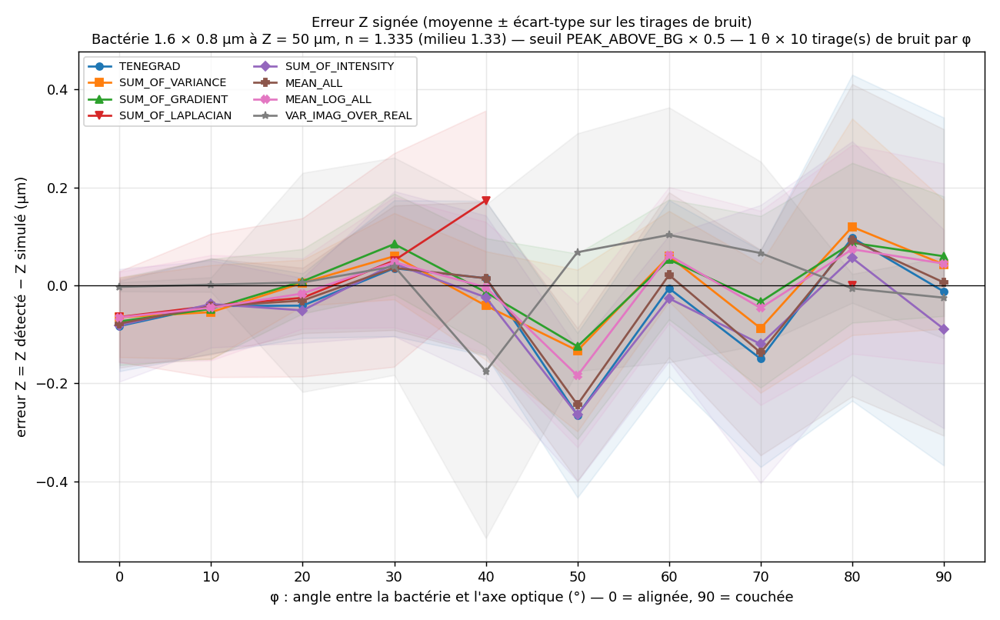
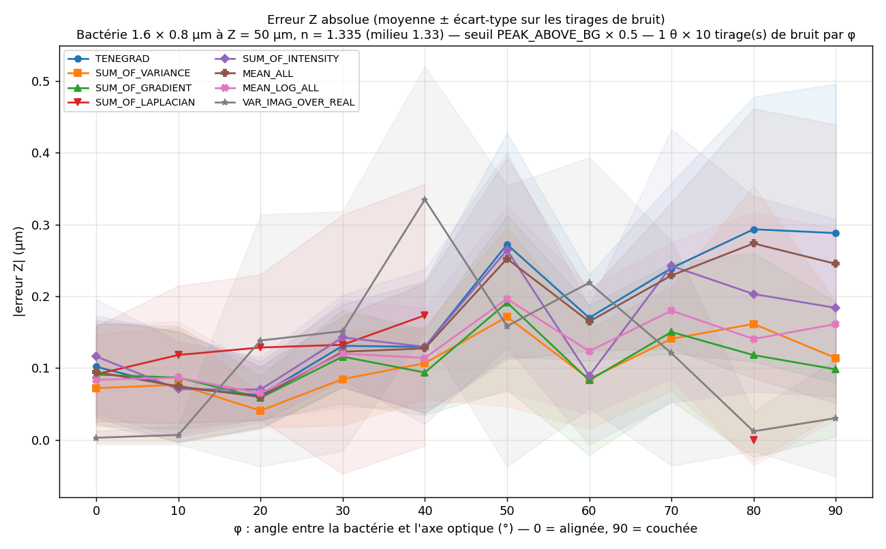
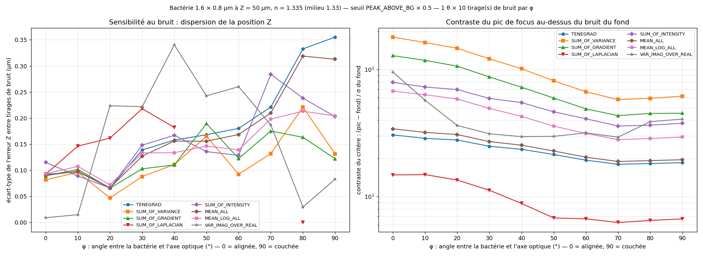
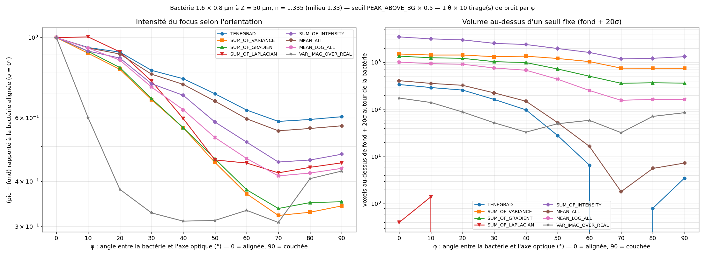

# Critères de focus et orientation des bactéries : erreur en Z, sensibilité au bruit et difficulté du seuillage

*Simu-Bacteria-Holograms, 2026-10-13*

## 1. Motivation

En holographie inline, on localise une bactérie en 3D en reconstruisant un volume par propagation
numérique, puis en cherchant où un **critère de focus** est maximal. Le critère d'HOLOTRACKER est
TENEGRAD. Ce rapport compare 8 critères sur trois questions :

1. **L'erreur de position en Z dépend-elle de l'orientation de la bactérie ?**
2. **Le critère est-il sensible au bruit ?** Autrement dit, la position Z change-t-elle d'un tirage
   de bruit à l'autre ?
3. **Comment l'orientation change-t-elle l'intensité du focus, et pourquoi est-il si difficile de
   trouver un seuil qui convienne à toutes les bactéries ?**

Le point de départ est physique. Une bactérie est un bâtonnet, et son déphasage vaut
2π·Δn·(trajet dans l'objet)/λ. Alignée sur l'axe optique, elle présente toute sa longueur au
faisceau ; couchée, seulement son épaisseur. Le signal d'une bactérie couchée est donc plus
faible. Dans un échantillon dense, les bactéries alignées, plus brillantes, imposent un seuil haut,
ou produisent de gros objets segmentés qui englobent leurs voisines couchées.

## 2. Méthode

**Simulation** (simulateur BPM multi-tranches du projet) :
- une bactérie de **1,6 µm × 0,8 µm**, d'indice n = 1,335, dans l'eau (n = 1,33), sans
  absorption, centrée à Z = 50 µm de l'hologramme ;
- caméra : pixel de 7 µm, grossissement ×40 (0,175 µm par pixel), 1024 × 1024 pixels,
  λ = 660 nm ;
- bruit capteur gaussien de 1,5 % de l'intensité du fond (valeur mesurée sur le film réel) ;
- orientation : φ, l'angle entre l'axe de la bactérie et l'axe optique, de 0° (alignée) à 90°
  (couchée) par pas de 10°. Pour chaque φ, **10 tirages de bruit**, soit 100 hologrammes au total.

Un seul azimut (θ = 0°) suffit : la chaîne de simulation et de détection est symétrique en X et Y.
Je l'ai vérifié sans bruit : les volumes masques pour θ = 0° et θ = 90° sont exactement transposés
l'un de l'autre, et donnent la même erreur Z.

**Détection** (chaîne HOLOTRACKER) :
- division par l'hologramme de référence ;
- propagation par spectre angulaire sur 200 plans espacés de 0,5 µm ;
- **filtre spectral en anneau** : on ne garde que les fréquences entre **15 et 250 pixels de
  Fourier** (`high_pass: 15`, `low_pass: 250`), ce qui coupe les fréquences spatiales au-delà
  d'environ 1,4 µm⁻¹ (ouverture numérique effective ≈ 0,69) et retire le bruit de haute fréquence ;
- critère de focus calculé sur une fenêtre de 11 × 11 pixels ;
- seuillage, composantes connexes, barycentre pondéré par le focus ;
- appariement avec la bactérie simulée (tolérances de 3 µm en XY et 5 µm en Z).

**Chaque hologramme est analysé avec les 8 critères** : un écart entre deux courbes ne peut venir
que du critère.

**Seuil de segmentation commun : mi-hauteur du pic au-dessus du fond** (`PEAK_ABOVE_BG` 0,5),
c'est-à-dire seuil = médiane + 0,5 × (max du volume − médiane). Un seuil en nombre
d'écarts-types ne se compare pas d'un critère à l'autre : un critère élevé au carré a une tout
autre dispersion.

**Mesures indépendantes du seuil**, autour de la position vraie, dans une boîte de ±3 µm en XY et
±5 µm en Z :
- **fond** : médiane du volume de focus ; **σ du fond** : 1,4826 × MAD ;
- **contraste** du critère : (pic − fond) / σ, c'est-à-dire la hauteur du pic exprimée en unités
  de bruit ;
- **pic au-dessus du fond**, rapporté à sa valeur pour la bactérie alignée (φ = 0°) ;
- **volume au-dessus d'un seuil fixe** : nombre de voxels au-dessus de fond + 20σ.

## 3. Les critères de focus comparés

Tous les critères, sauf le dernier, sont calculés sur le **module** |E| du champ reconstruit, plan
par plan. La « moyenne locale » est une moyenne sur une fenêtre de 11 × 11 pixels. gx et gy sont
les dérivées de Sobel.

| Critère | Ce qu'il mesure | Formule (par plan) | Réponse au contraste |
|---|---|---|---|
| **TENEGRAD** | Netteté des bords | moyenne locale de √(gx² + gy²) | linéaire |
| **SUM_OF_GRADIENT** | Énergie du gradient | moyenne locale de gx² + gy² | quadratique |
| **SUM_OF_VARIANCE** | Contraste autour de la moyenne locale | moyenne locale de (\|E\| − moyenne locale de \|E\|)² | quadratique |
| **SUM_OF_LAPLACIAN** | Détails fins (dérivée seconde) | moyenne locale de (∇²\|E\|)² | quadratique, très sensible aux hautes fréquences |
| **SUM_OF_INTENSITY** | Concentration de la lumière | moyenne locale de \|E\|² | quadratique |
| **MEAN_ALL** | Moyenne arithmétique des 5 critères ci-dessus | (T + G + V + L + I) / 5 | mixte |
| **MEAN_LOG_ALL** | Moyenne géométrique des 5 critères ci-dessus | exp(moyenne des log) | mixte |
| **VAR_IMAG_OVER_REAL** | Spécifique aux objets de phase : au focus, la perturbation est imaginaire (t ≈ 1 + iφ) | variance locale de Im(E) / variance locale de Re(E), sur le champ **complexe**, phase de référence exp(2iπz/λ) retirée | rapport, ≈ 1 dans le bruit |

TENEGRAD et SUM_OF_GRADIENT reposent sur le même gradient : TENEGRAD le prend en norme,
SUM_OF_GRADIENT au carré. Cette différence explique une bonne partie des résultats ci-dessous.

## 4. Résultats

### 4.1 Erreur en Z selon l'orientation

| Critère | \|err Z\|, φ = 0° (µm) | \|err Z\|, φ = 90° (µm) | \|err Z\| moyenne, tous angles (µm) | err XY max (µm) |
|---|---:|---:|---:|---:|
| SUM_OF_VARIANCE | 0,07 | **0,11** | **0,11** | 0,11 |
| SUM_OF_GRADIENT | 0,09 | **0,10** | **0,11** | 0,11 |
| MEAN_LOG_ALL | 0,08 | 0,16 | 0,13 | 0,12 |
| SUM_OF_INTENSITY | 0,12 | 0,18 | 0,15 | 0,07 |
| MEAN_ALL | 0,09 | 0,25 | 0,16 | 0,10 |
| TENEGRAD | 0,10 | **0,29** | 0,18 | 0,10 |
| VAR_IMAG_OVER_REAL | 0,00 | 0,03 | 0,12 (max 0,33 à 40°) | **0,78** |
| SUM_OF_LAPLACIAN | 0,09 | non détectée (dès φ ≥ 50°) | | 0,26 |

- **Pas de biais systématique** : l'erreur signée oscille entre −0,26 et +0,12 µm autour de 0, sans
  tendance selon l'orientation, pour tous les critères.
- **Bactérie alignée (φ ≤ 20°) : tous se valent**, à moins de 0,12 µm, soit un quart de plan de
  reconstruction.
- **Bactérie couchée : l'erreur de TENEGRAD et de MEAN_ALL triple** (0,10 → 0,29 µm), alors que
  SUM_OF_VARIANCE et SUM_OF_GRADIENT restent à environ 0,1 µm.
- **VAR_IMAG_OVER_REAL est quasi parfait en Z à 0° et à 80–90°** (≤ 0,03 µm), moins bon entre
  20° et 70° (jusqu'à 0,33 µm), et le moins bon en XY (jusqu'à 0,8 µm).

### 4.2 Sensibilité au bruit

**À gauche : l'écart-type de l'erreur Z** entre les 10 tirages de bruit, c'est-à-dire la dispersion
de la position. **À droite : le contraste du critère**, soit la hauteur du pic au-dessus du fond en
unités de bruit (échelle logarithmique).

| Critère | Dispersion Z, φ = 0° (µm) | Dispersion Z, φ = 90° (µm) | Contraste, φ = 0° | Contraste, φ = 90° | Objets détectés à φ = 90° |
|---|---:|---:|---:|---:|---:|
| SUM_OF_VARIANCE | 0,08 | **0,13** | **180 σ** | **62 σ** | **1,0** |
| SUM_OF_GRADIENT | 0,09 | 0,12 | 129 σ | 45 σ | 1,3 |
| SUM_OF_INTENSITY | 0,12 | 0,20 | 79 σ | 38 σ | 1,0 |
| MEAN_LOG_ALL | 0,09 | 0,20 | 68 σ | 29 σ | 2,7 |
| VAR_IMAG_OVER_REAL | 0,01 | 0,08 (max 0,34 à 40°) | 96 σ | 41 σ | 38 |
| MEAN_ALL | 0,09 | 0,31 | 34 σ | 20 σ | 14 |
| TENEGRAD | 0,09 | **0,36** | **31 σ** | **19 σ** | **22** |
| SUM_OF_LAPLACIAN | 0,09 | non détectée | 15 σ | 7 σ | ≈ 560 |

- **TENEGRAD est le plus sensible au bruit.** Pour une bactérie couchée, sa position Z varie de
  ±0,36 µm d'un tirage à l'autre, 4 fois plus que pour une bactérie alignée. SUM_OF_VARIANCE et
  SUM_OF_GRADIENT restent à environ ±0,13 µm.
- **L'explication est le contraste.** Le pic de TENEGRAD ne dépasse le bruit que de 19σ pour une
  bactérie couchée, contre 62σ pour SUM_OF_VARIANCE. Plus le pic est proche du bruit, plus le bruit
  déplace son maximum, et plus des pics de bruit dépassent la mi-hauteur. C'est ce qui donne
  22 objets parasites pour TENEGRAD, contre 1 pour SUM_OF_VARIANCE.
- **Les critères quadratiques ont un contraste 3 à 6 fois plus élevé** : élever au carré creuse
  l'écart entre le pic et le fond.

**SUM_OF_LAPLACIAN reste limité, malgré le filtre passe-bas.** Le filtre a nettement amélioré son
contraste : pour une bactérie de taille quasi identique (1,5 × 0,8 µm) sans filtre passe-bas, il
plafonnait à 6,5σ à φ = 0° ; avec `low_pass: 250`, il atteint 15σ, et la bactérie est désormais
détectée à tous les tirages pour φ ≤ 20°. Mais il échoue encore pour une bactérie inclinée :

| φ | 0° | 10° | 20° | 30° | 40° | 50° à 90° |
|---|---|---|---|---|---|---|
| Détectée (sur 10 tirages) | 10 | 10 | 10 | 7 | 3 | 0, sauf 1 à 80° |
| Pic de la bactérie | 14,8 σ | 14,9 σ | 13,5 σ | 11,2 σ | 8,9 σ | 6,3 à 6,8 σ |
| Seuil appliqué | ≈ 10 σ | ≈ 10 σ | ≈ 10 σ | ≈ 10 σ | ≈ 10 σ | ≈ 10 σ |

La cause : le seuil est placé à mi-hauteur entre le fond et le **maximum du volume entier**. Pour
SUM_OF_VARIANCE, ce maximum est la bactérie, et le seuil suit son pic. Pour le laplacien, c'est un
pic de **bruit**, d'environ 20σ sur 200 millions de voxels. Le seuil se fixe donc vers 10σ, quelle
que soit l'orientation. Quand le pic de la bactérie descend sous 10σ (φ ≥ 40°), elle disparaît,
et les ≈ 560 objets détectés sont des pics de bruit.

### 4.3 Effet de l'orientation sur l'intensité du focus, et difficulté du seuillage

**À gauche** : la hauteur du pic au-dessus du fond, rapportée à la bactérie alignée (échelle
logarithmique). **À droite** : le nombre de voxels autour de la bactérie au-dessus d'un **seuil
fixe** de fond + 20σ.

| Critère | Pic couchée / pic alignée | Contraste alignée → couchée | Voxels > 20σ, alignée → couchée |
|---|---:|---:|---:|
| TENEGRAD | 0,60 (÷ 1,7) | 31 σ → 19 σ | 338 → **3,5** |
| MEAN_ALL | 0,57 (÷ 1,8) | 34 σ → 20 σ | 408 → 7 |
| SUM_OF_INTENSITY | 0,48 (÷ 2,1) | 79 σ → 38 σ | 3 459 → 1 317 |
| SUM_OF_LAPLACIAN | 0,45 (÷ 2,2) | 15 σ → 7 σ | 0 → 0 |
| MEAN_LOG_ALL | 0,43 (÷ 2,3) | 68 σ → 29 σ | 1 009 → 164 |
| VAR_IMAG_OVER_REAL | 0,43 (÷ 2,3) | 96 σ → 41 σ | 175 → 85 |
| SUM_OF_GRADIENT | 0,35 (÷ 2,9) | 129 σ → 45 σ | 1 351 → 362 |
| SUM_OF_VARIANCE | 0,34 (÷ 2,9) | 180 σ → 62 σ | 1 504 → 743 |

- **Le signal de focus d'une bactérie couchée est 1,7 à 2,9 fois plus faible que celui d'une
  bactérie alignée**, selon le critère. Les critères quadratiques élèvent au carré l'écart dû à
  l'orientation : TENEGRAD divise le pic par 1,7, son équivalent au carré SUM_OF_GRADIENT par 2,9,
  soit environ 1,7².
- **L'écart reste modéré** parce que la bactérie est courte : 1,6 × 0,8 µm, soit un rapport
  longueur / épaisseur de 2. L'effet croît avec l'allongement de la bactérie, puisque le déphasage
  suit le trajet de la lumière dans l'objet.
- **Même ici, aucun seuil fixe ne convient aux deux orientations.** Pour détecter une bactérie
  couchée, le seuil doit rester sous son contraste : moins de 19σ avec TENEGRAD, moins de 62σ avec
  SUM_OF_VARIANCE. À fond + 20σ, TENEGRAD ne retient déjà presque plus rien d'une bactérie couchée
  (3,5 voxels en moyenne), alors qu'une bactérie alignée occupe encore 338 voxels.
- **Abaisser le seuil pour garder les bactéries couchées fait grossir les bactéries alignées.**
  Elles dépassent alors le seuil plus haut, et leur réponse au-dessus du seuil s'étend loin autour
  d'elles : la réponse axiale fait environ 12 µm, et le volume segmenté dépend de l'orientation à
  la puissance 3 environ (`CLAUDE.md`). En milieu dense, ces gros objets touchent les bactéries
  voisines et fusionnent avec elles. **La bactérie alignée « avale » sa voisine couchée** ;
  relever le seuil pour l'éviter fait disparaître les bactéries couchées.
- **Meilleur contraste et plus grande variabilité avec l'orientation vont ensemble.** Élever au
  carré élève au carré tous les rapports : le rapport pic / bruit du capteur (d'où le meilleur
  contraste de VARIANCE et GRADIENT) comme le rapport bactérie alignée / bactérie couchée (÷ 2,9
  au lieu de ÷ 1,7, soit à peu près 1,7²). Pour une transformation appliquée voxel par voxel,
  comme élever au carré, le seuillage est d'ailleurs invariant : seuiller F à T ou F² à T² donne
  le même volume. La plus grande variabilité des critères au carré n'est donc **pas un défaut en
  soi**.
- **Ce qui décide, c'est la nature du fond.** Pour une bactérie isolée, le fond est le bruit du
  capteur, faible et indépendant des objets : le carré l'écrase plus qu'il n'écrase la bactérie
  couchée, et VARIANCE et GRADIENT gardent une large marge. Au seuil fixe de 20σ, VARIANCE garde
  743 voxels de la bactérie couchée, quand TENEGRAD n'en garde que 3,5. En milieu dense, le fond
  s'enrichit du halo des bactéries voisines, proportionnel à leur signal, que le carré amplifie
  aussi. C'est mesuré dans **`../DENSE/RAPPORT_DENSE.md`** : pour des bactéries de
  1,5–2 × 0,8 µm, ce halo reste faible (fond local × 1,37 pour SUM_OF_VARIANCE et × 1,14 pour
  TENEGRAD entre 5 et 200 bactéries), et l'avantage des critères au carré se maintient.
  SUM_OF_VARIANCE retrouve 92 % des bactéries à N = 200 (85 % des couchées), contre 83 % (70 %)
  pour TENEGRAD.

## 5. Conclusions

1. **Erreur en Z** : SUM_OF_VARIANCE et SUM_OF_GRADIENT localisent une bactérie isolée à environ
   0,1 µm près quelle que soit son orientation. TENEGRAD, le critère d'HOLOTRACKER, se dégrade
   quand la bactérie se couche (0,29 µm à 90°). Aucun critère n'a de biais systématique.
2. **Sensibilité au bruit** : c'est le défaut principal de TENEGRAD. Le pic d'une bactérie couchée
   n'est qu'à 19σ du bruit, et sa position Z varie de ±0,36 µm d'un tirage à l'autre, contre
   ±0,13 µm pour SUM_OF_VARIANCE (62σ). Les critères quadratiques sont nettement plus robustes.
3. **Seuillage** : l'orientation divise l'intensité du focus par 1,7 à 2,9. Aucun seuil unique ne garde les
   bactéries couchées sans faire grossir les bactéries alignées, qui fusionnent alors avec leurs
   voisines en milieu dense. La plus grande variabilité des critères au carré est la contrepartie
   de leur meilleur contraste. Elle ne gêne pas tant que le halo des voisines reste faible, ce qui
   est le cas pour ces bactéries jusqu'à 200 par hologramme (`../DENSE/RAPPORT_DENSE.md`). Changer
   de critère réduit les pertes de bactéries couchées sans les supprimer : c'est l'argument
   central pour une détection qui ne repose pas sur un seuil d'intensité (seuil local,
   normalisation par objet, U-Net 3D).
4. **Filtre spectral** : le filtre passe-bas (`low_pass: 250`) améliore nettement le laplacien
   (15σ au lieu de 6,5σ à φ = 0°), sans le rendre utilisable pour des bactéries inclinées de plus
   de 30°.
5. **Recommandation** : remplacer TENEGRAD par SUM_OF_VARIANCE dans HOLOTRACKER, **pour localiser**
   (précision en Z, robustesse au bruit) **et pour détecter** : en milieu dense, il retrouve 92 % des
   bactéries à N = 200 contre 83 % pour TENEGRAD (`../DENSE/RAPPORT_DENSE.md`). Ne
   pas utiliser SUM_OF_LAPLACIAN. Réserver VAR_IMAG_OVER_REAL à un éventuel affinage en Z de
   bactéries déjà détectées, et ce uniquement pour φ proche de 0° ou de 90°.

## 6. Limites

- Une seule taille de bactérie (1,6 × 0,8 µm), une seule distance (Z = 50 µm), une seule bactérie
  par hologramme. Le milieu dense est traité dans `../DENSE/RAPPORT_DENSE.md`.
- 10 tirages de bruit par angle : la dispersion est estimée à environ ±25 % près.
- L'amélioration du laplacien est attribuée au filtre passe-bas par comparaison avec un essai à
  taille de bactérie quasi identique (1,5 × 0,8 µm, sans passe-bas, 2 tirages). Ce n'est pas un
  test contrôlé où seul le filtre change.
- Le volume au-dessus du seuil est compté dans une boîte de ±3 µm × ±3 µm × ±5 µm. Pour une
  bactérie alignée, le volume réel au-dessus du seuil est plus grand que celui mesuré : l'écart
  entre orientations est donc sous-estimé.
- Les erreurs dépendent du seuil de segmentation (mi-hauteur du pic au-dessus du fond). Un autre
  seuil changerait les valeurs absolues, mais pas le mécanisme.

**Correction d'une version antérieure** (même jour) : une première version de ce rapport reposait
sur 4 hologrammes par angle. Elle concluait à un « biais » de TENEGRAD d'environ −0,7 µm pour une
bactérie couchée, et à un effet de la direction de couchage (selon X ou selon Y). Avec 10 tirages,
ces deux effets disparaissent : c'étaient des fluctuations dues au bruit, exactement la sensibilité
décrite au § 4.2. Le code d'orientation et d'insertion de la bactérie a été vérifié : il est
symétrique en X et Y.

## 7. Fichiers

| Fichier | Contenu |
|---|---|
| `RAPPORT_FOCUS.md` | ce rapport |
| `erreur_Z_vs_orientation.png` | erreur Z signée = f(φ), moyenne ± écart-type, une courbe par critère |
| `abs_erreur_Z_vs_orientation.png` | \|erreur Z\| = f(φ) |
| `sensibilite_bruit_vs_orientation.png` | dispersion de l'erreur Z due au bruit, et contraste du critère = f(φ) |
| `intensite_focus_vs_orientation.png` | pic de focus rapporté à la bactérie alignée, et volume au-dessus de fond + 20σ = f(φ) |
| `resultats_par_focus_et_orientation.csv` | une ligne par (critère, φ) : taux de détection, objets détectés, erreurs Z (moyenne, écart-type), \|Z\|, XY, 3D, contraste, pic relatif, voxels > 20σ |
| `donnees_brutes_par_hologramme.csv` | une ligne par (hologramme, critère) : positions vraie et détectée, erreurs, seuil, fond, σ, pic, contraste, voxels > 5σ et > 20σ |
| `configuration.yaml` | configuration exacte utilisée |

**Reproduire** (environ 35 minutes sur une Quadro RTX 3000) :
`python stats/stat_report_orientation_focus.py stats/stat_report_orientation_focus.yaml`
Les données brutes viennent de `output/stat_report_orientation_focus_2026_10_13_11_25/`.
