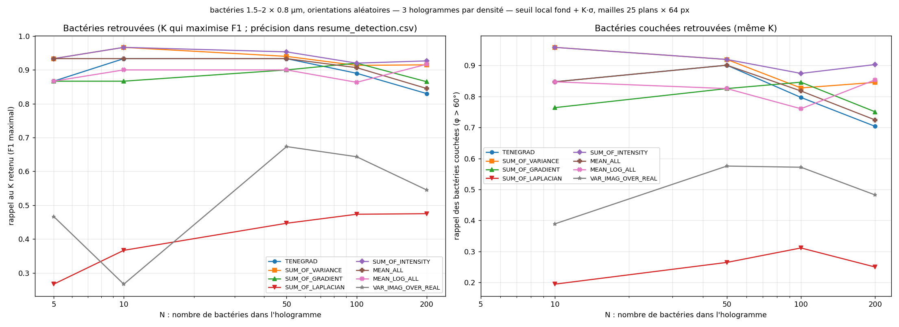
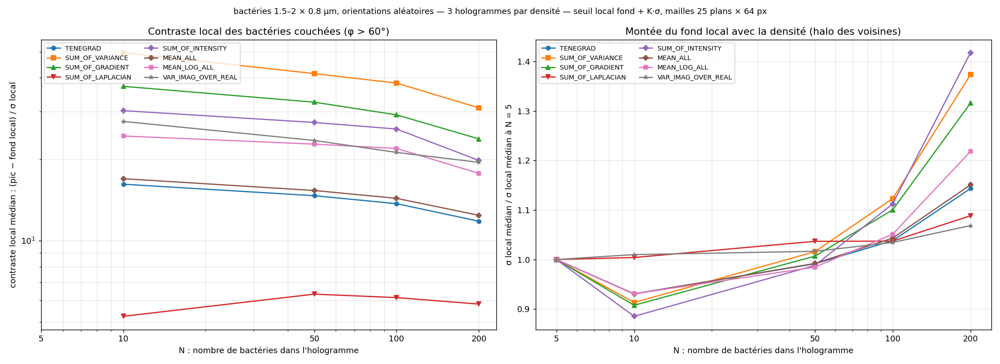
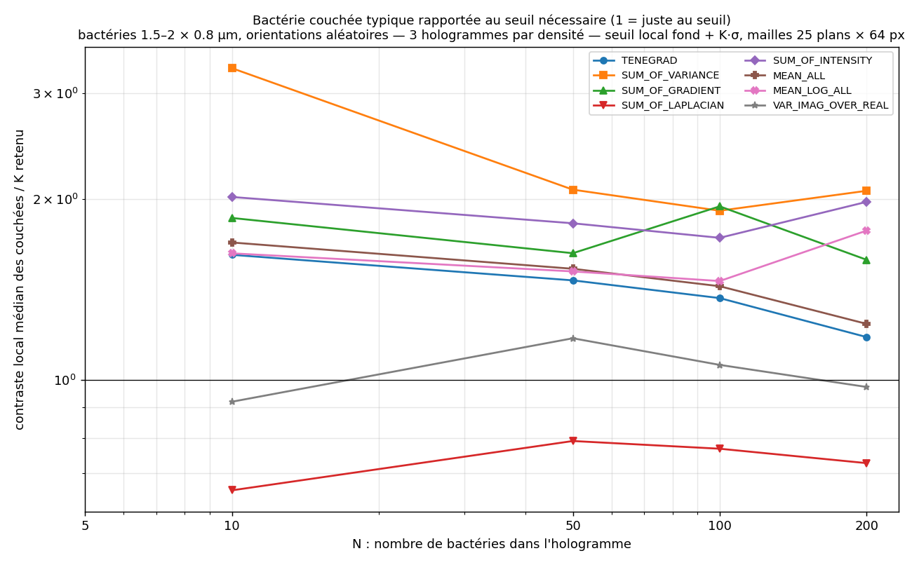
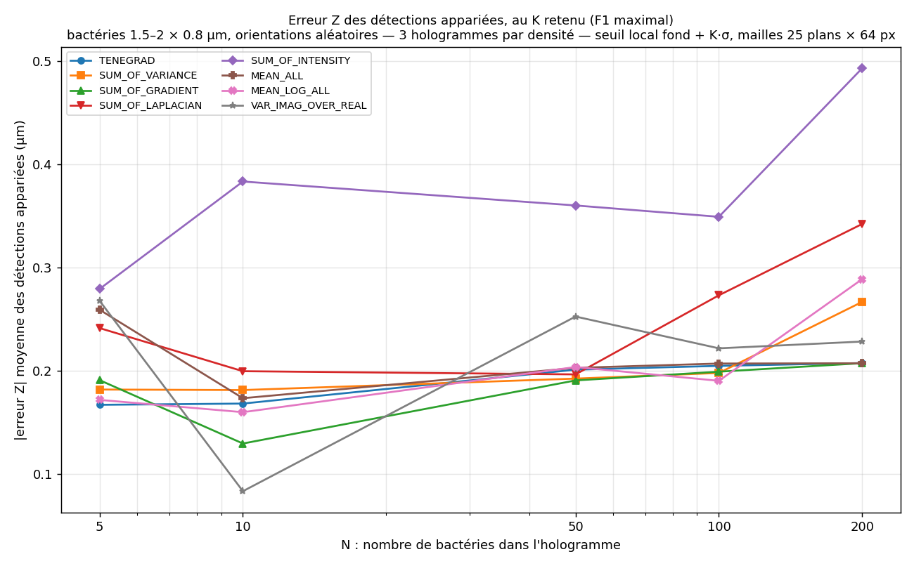

# Critères de focus en milieu dense : détection, contraste local et orientation

*Simu-Bacteria-Holograms, 2026-10-13 — suite de `../1_bacteria/RAPPORT_FOCUS.md`*

## 1. Motivation

Le rapport `1_bacteria` étudie une bactérie **isolée**. Les critères élevés au carré
(SUM_OF_VARIANCE, SUM_OF_GRADIENT) y ont un meilleur contraste face au bruit du capteur et une
meilleure précision en Z que TENEGRAD, mais leur intensité varie plus avec l'orientation. Ces deux
propriétés viennent de la même opération : élever au carré élève au carré tous les rapports, le
rapport pic / bruit comme le rapport bactérie alignée / bactérie couchée.

Reste à savoir ce que ces propriétés deviennent **quand le fond n'est plus seulement le bruit du
capteur, mais aussi le halo des bactéries voisines** (leurs réponses défocalisées et leurs
franges). Ce halo est proportionnel au signal des objets, et le carré l'amplifie aussi. Ce rapport
mesure :
1. la capacité de détection de chaque critère selon la densité (5 à 200 bactéries) ;
2. le contraste **local** des bactéries (pic rapporté au fond et au σ de leur voisinage) et la
   montée de ce fond local avec la densité ;
3. le contraste des bactéries couchées rapporté au seuil réellement nécessaire.

## 2. Méthode

**Simulation** (`simu holo script/main_simu_hologram.py`, hologrammes conservés dans
`holograms/`) :
- **N = 5, 10, 50, 100 et 200 bactéries par hologramme**, **3 hologrammes par densité** ;
- bactéries de **1,5 à 2 µm de long et 0,8 µm d'épaisseur** (dimensions des bactéries étudiées),
  n = 1,335 dans l'eau, positions aléatoires dans un volume de 179 × 179 × 100 µm, orientation
  aléatoire (φ uniforme dans [0°, 90°], θ dans [0°, 360°)) ;
- pixel caméra de 7 µm, grossissement ×40 (0,175 µm par pixel), 1024 × 1024 pixels, 200 plans de
  0,5 µm, premier plan à 10 µm de l'hologramme, λ = 660 nm ;
- bruit capteur de 1,5 %, et hologramme de référence équivalent à une moyenne de 16 images.

**Reconstruction** : division par la référence, à la puissance 0,8 (comme HOLOTRACKER), filtre
spectral 15–250 px, propagation par spectre angulaire, puis les 8 critères de focus de
`1_bacteria` (fenêtre de 11 px).

**Fond local** : médiane et σ du volume de focus estimés par mailles de 25 plans × 64 × 64 px
(12,5 × 11,2 × 11,2 µm), en écartant les voxels à plus de 3σ sur 3 passes, de sorte que les objets
ne comptent pas dans leur propre fond. C'est le fond du seuil local
(`pipeline_holotracker_locate_local_threshold.py`).

**Mesures par bactérie** (indépendantes de la détection) : **contraste local** =
(pic du focus à ±1,5 µm en XY et ±3 µm en Z de la position vraie − fond local) / σ local.

**Détection** : seuil local fond + K·max(σ, σ plancher), composantes connexes, barycentre,
appariement avec les bactéries simulées (tolérances de 3 µm en XY et 5 µm en Z), pour
K = 4, 6, 8, 10, 15, 20, 30, 50, 100 et 200. **Pour chaque (N, critère), on retient le K qui
maximise F1** = 2·P·R / (P + R), où P est la précision et R le rappel (fraction des bactéries
retrouvées), sommés sur les 3 hologrammes. Une contrainte du type « précision ≥ 95 % » est
inutilisable à faible densité : avec 5 bactéries, un seul faux positif sur 3 hologrammes donne 94 %.

**Bactéries couchées** (φ > 60°) : leur nombre dépend du tirage (1 à N = 5, 14 à N = 10, 49 à
N = 50, 107 à N = 100, 215 à N = 200). Les valeurs « couchées » ne sont pas publiées sur moins de
5 bactéries, ce qui exclut N = 5.

## 3. Résultats

### 3.1 Détection selon la densité

Au K retenu (F1 maximal) :

| Critère | Rappel N = 10 / 50 / 200 | Précision N = 200 | Couchées retrouvées, N = 50 / 200 | Alignées (φ < 30°) retrouvées, N = 200 | Faux positifs / hologramme, N = 200 |
|---|---|---:|---|---:|---:|
| SUM_OF_VARIANCE | 0,97 / 0,94 / **0,92** | 0,94 | 0,92 / **0,85** | 0,98 | 12 |
| SUM_OF_INTENSITY | 0,97 / 0,95 / **0,93** | 0,92 | 0,92 / **0,90** | 0,95 | 16 |
| MEAN_LOG_ALL | 0,90 / 0,90 / 0,92 | 0,87 | 0,83 / 0,85 | 0,98 | 28 |
| SUM_OF_GRADIENT | 0,87 / 0,90 / 0,86 | 0,95 | 0,83 / 0,75 | 0,97 | 10 |
| MEAN_ALL | 0,93 / 0,93 / 0,84 | 0,96 | 0,90 / 0,72 | 0,96 | 7 |
| TENEGRAD | 0,93 / 0,93 / **0,83** | 0,96 | 0,90 / **0,70** | 0,95 | 8 |
| VAR_IMAG_OVER_REAL | 0,27 / 0,67 / 0,55 | 0,59 | 0,58 / 0,48 | 0,67 | 75 |
| SUM_OF_LAPLACIAN | 0,37 / 0,45 / 0,48 | 0,74 | 0,26 / 0,25 | 0,75 | 34 |

- **Jusqu'à 50 bactéries, les six premiers critères se valent** (87 à 97 % de rappel).
- **À 200 bactéries, SUM_OF_VARIANCE et SUM_OF_INTENSITY détectent nettement mieux que TENEGRAD** :
  92–93 % de rappel contre 83 %, et surtout 85–90 % des bactéries couchées contre 70 %. La
  précision reste comparable (92–94 % contre 96 %).
- **Les bactéries alignées sont presque toutes retrouvées** (95 à 98 %) par tous ces critères ;
  l'écart entre critères porte sur les bactéries couchées.
- **SUM_OF_LAPLACIAN et VAR_IMAG_OVER_REAL sont inutilisables** : moins de 70 % de rappel à toutes
  les densités, même pour les bactéries alignées.

### 3.2 Contraste local et montée du fond

| Critère | σ local à N = 200 / σ local à N = 5 | Contraste local médian des couchées, N = 10 → 200 |
|---|---:|---|
| SUM_OF_VARIANCE | × 1,37 | **49,6σ → 31,0σ** |
| SUM_OF_GRADIENT | × 1,32 | 37,2σ → 23,8σ |
| SUM_OF_INTENSITY | × 1,42 | 30,3σ → 19,8σ |
| VAR_IMAG_OVER_REAL | × 1,07 | 27,6σ → 19,5σ |
| MEAN_LOG_ALL | × 1,22 | 24,4σ → 17,7σ |
| MEAN_ALL | × 1,15 | 16,9σ → 12,4σ |
| TENEGRAD | × 1,14 | **16,2σ → 11,8σ** |
| SUM_OF_LAPLACIAN | × 1,09 | 5,2σ → 5,8σ |

- **Le fond local monte avec la densité, mais peu** pour des bactéries de cette taille : de × 1,1
  à × 1,4 entre 5 et 200 bactéries. Les critères au carré (VARIANCE, GRADIENT, INTENSITY) montent un
  peu plus vite que TENEGRAD (× 1,3–1,4 contre × 1,14) : le carré amplifie aussi le halo, mais ce
  halo reste faible.
- **L'avantage de contraste des critères au carré se maintient donc** : pour les bactéries couchées,
  SUM_OF_VARIANCE a un contraste 3,1 fois celui de TENEGRAD à N = 10 et encore 2,6 fois à N = 200.
- Le léger creux à N = 10 (σ local en dessous de sa valeur à N = 5) reflète la variabilité d'un
  tirage à l'autre sur 3 hologrammes, pas un effet physique.

### 3.3 Contraste rapporté au seuil nécessaire

Un contraste exprimé en σ ne se compare pas d'un critère à l'autre : avec un critère au carré, les
pics du fond sont aussi élevés au carré, et il faut un seuil K plus élevé pour écarter les faux
positifs (au K retenu : 15 à 20 pour SUM_OF_VARIANCE, 10 pour TENEGRAD). La mesure pertinente est
le contraste de la bactérie couchée typique **divisé par le K nécessaire** (1 = juste au niveau du
seuil) :

| Critère | N = 10 | N = 50 | N = 200 |
|---|---:|---:|---:|
| SUM_OF_VARIANCE | **3,30** | 2,07 | **2,06** |
| SUM_OF_INTENSITY | 2,02 | 1,82 | 1,98 |
| SUM_OF_GRADIENT | 1,86 | 1,63 | 1,58 |
| MEAN_LOG_ALL | 1,62 | 1,52 | 1,77 |
| MEAN_ALL | 1,69 | 1,53 | 1,24 |
| TENEGRAD | 1,62 | 1,46 | **1,18** |
| VAR_IMAG_OVER_REAL | 0,92 | 1,17 | 0,97 |
| SUM_OF_LAPLACIAN | 0,66 | 0,79 | 0,73 |

- **SUM_OF_VARIANCE garde la plus grande marge à toutes les densités** : la bactérie couchée typique
  est environ 2 fois au-dessus du seuil nécessaire, même à 200 bactéries.
- **TENEGRAD se rapproche du seuil** quand la densité augmente (1,18 à N = 200), ce qui explique
  qu'il perde des bactéries couchées (§ 3.1).
- **SUM_OF_LAPLACIAN et VAR_IMAG_OVER_REAL sont sous 1 ou autour de 1** : la bactérie couchée
  typique n'atteint pas le seuil.

### 3.4 Erreur de position en milieu dense

|erreur Z| moyenne des détections appariées, au K retenu : **0,13 à 0,29 µm** pour TENEGRAD,
SUM_OF_VARIANCE, SUM_OF_GRADIENT et les moyennes de critères, avec une légère hausse avec la
densité ; **0,28 à 0,49 µm** pour SUM_OF_INTENSITY. Ces valeurs sont du même ordre que pour une
bactérie isolée (`1_bacteria`, 0,1 à 0,3 µm), bien que la segmentation diffère (seuil local
fond + K·σ ici, mi-hauteur du pic au-dessus du fond dans `1_bacteria`). SUM_OF_INTENSITY, aussi bon
que SUM_OF_VARIANCE pour détecter, localise moins bien en Z.

## 4. Conclusions

1. **Avec des bactéries de 1,5–2 × 0,8 µm, le halo des voisines reste faible** : le fond local
   n'augmente que de 10 à 40 % entre 5 et 200 bactéries. Le carré l'amplifie un peu plus pour
   VARIANCE et GRADIENT, mais pas assez pour annuler leur meilleur contraste.
2. **SUM_OF_VARIANCE est le meilleur critère aussi en milieu dense** : 92 % de rappel à
   200 bactéries (TENEGRAD : 83 %), 85 % des bactéries couchées (TENEGRAD : 70 %), une précision de
   94 % et une erreur Z de 0,2 à 0,3 µm. Sa marge au-dessus du seuil nécessaire reste d'environ 2 à
   toutes les densités, contre 1,2 pour TENEGRAD à N = 200.
3. **SUM_OF_INTENSITY détecte aussi bien**, et retrouve même un peu plus de bactéries couchées
   (90 %), mais localise moins bien en Z (0,3 à 0,5 µm).
4. **TENEGRAD, le critère actuel d'HOLOTRACKER, est le moins bon des critères utilisables à forte
   densité**, à cause de son faible contraste : la bactérie couchée typique est à peine au-dessus du
   seuil.
5. **Recommandation, avec `1_bacteria`** : **SUM_OF_VARIANCE pour localiser et pour détecter**. À
   exclure : SUM_OF_LAPLACIAN et VAR_IMAG_OVER_REAL.
6. **Les pertes restantes portent sur les bactéries couchées** (15 % avec SUM_OF_VARIANCE à
   N = 200). Pour aller plus loin : retrait des contributions déjà expliquées (CLEAN,
   `CLAUDE_HOLOTRACKER_TO_DO.md` § 2.6), normalisation par objet, ou U-Net 3D.

## 5. Limites

- 3 hologrammes par densité : à N = 5, une seule bactérie couchée au total, et à N = 10, 14. Les
  écarts de quelques points entre critères à faible densité ne sont pas significatifs ; ceux de
  10 à 20 points à N = 200 (215 bactéries couchées) le sont davantage.
- Une seule géométrie (Z de 10 à 110 µm, champ de 179 µm), une seule population de bactéries.
- Le K est choisi parmi 10 valeurs : le K optimal réel peut se trouver entre deux.
- La première version des benchmarks de `RAPPORT_DETECTION_SEUIL_FOCUS.md` (2026-10-12) utilisait des
  bactéries de 3–4 × 1–2 µm, bien plus grosses que les bactéries étudiées, et concluait à trois
  critères équivalents. Ces benchmarks ont été refaits le 2026-10-13 sur les hologrammes de ce
  rapport (seuil global, seuil local, maxima locaux, taille des mailles) : ils confirment l'avantage
  de SUM_OF_VARIANCE.

## 6. Fichiers

| Fichier | Contenu |
|---|---|
| `RAPPORT_DENSE.md` | ce rapport |
| `rappel_vs_densite.png` | rappel (toutes, couchées) au K retenu = f(N) |
| `contraste_local_vs_densite.png` | contraste local médian des couchées, et montée du σ local = f(N) |
| `contraste_sur_seuil_vs_densite.png` | contraste local des couchées / K retenu = f(N) |
| `erreur_Z_vs_densite.png` | \|erreur Z\| des détections appariées = f(N) |
| `resume_detection.csv` | par (N, critère) : K retenu, rappel, précision, F1, faux positifs par hologramme, nombre de couchées, rappel couchées et alignées, erreurs, contraste des couchées, contraste / K |
| `detection.csv` | par (hologramme, critère, K) : détections, vrais positifs, rappels, erreurs |
| `bacteries.csv` | par (hologramme, critère, bactérie) : φ, taille, contraste local et global, σ local |
| `holograms/N<densité>/` | hologrammes simulés (`.npy`, `.bmp`), références, positions et orientations vraies, configuration de simulation |
| `stat_report_dense_focus.yaml` | configuration utilisée |

**Reproduire** : `python stats/stat_report_dense_focus.py stats/stat_report_dense_focus.yaml`. Les
hologrammes existants sont relus (`reuse_holograms: true`), soit environ 8 minutes de détection.
Avec `--figures-only`, seuls le résumé et les figures sont recalculés à partir des CSV.
