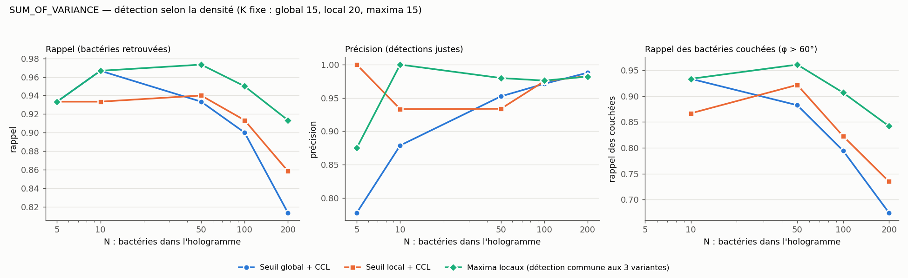
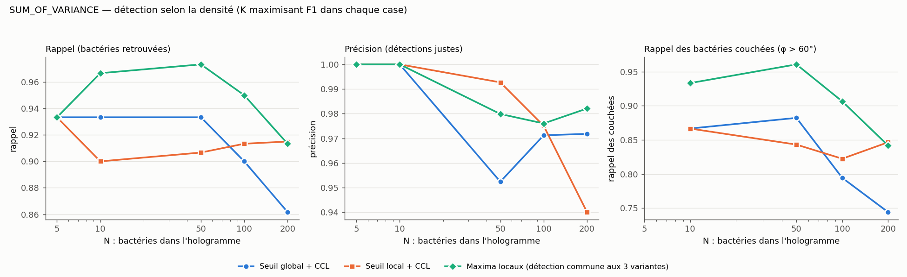
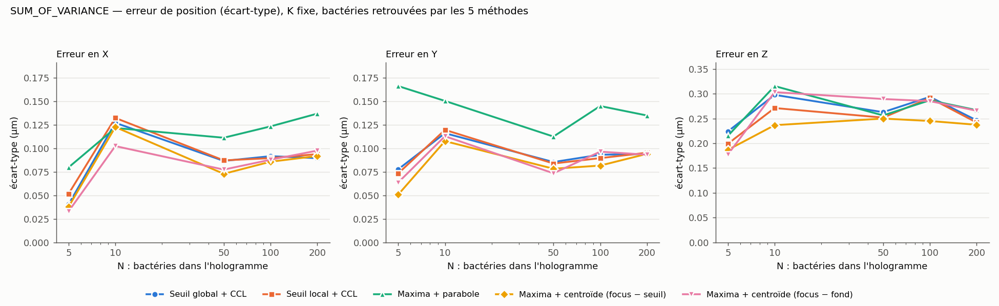

# Segmentation et localisation en milieu dense : comparaison de 5 méthodes

Rapport du 2026-10-13. Script : `stats/stat_report_dense_segmentation.py`, avec la configuration
`stat_report_dense_segmentation.yaml` (copiée ici).

## 1. Motivation

HOLOTRACKER détecte les bactéries par un seuil global suivi de composantes connexes (CCL). Les
mesures précédentes (`FOCUS_REPORT/DENSE`, `RAPPORT_DETECTION_SEUIL_FOCUS.md`,
`CLAUDE_HOLOTRACKER_TO_DO.md` section R) ont montré deux défauts de ce choix :
- le bon K du seuil global dépend de la densité ;
- un seuil local suivi d'une CCL fragmente les bactéries faibles.

Elles ont aussi proposé deux remèdes : les maxima locaux, et plusieurs façons d'en tirer une
position. Ce rapport compare les cinq variantes **sur les mêmes hologrammes et le même volume de
focus**, sur les deux tâches : **détecter** (rappel, précision) et **positionner** (erreur en X,
Y et Z).

## 2. Les 5 méthodes

Le volume de focus est le même pour toutes (critère SUM_OF_VARIANCE).

| # | Méthode | Ce qui est détecté | Position | Paramètres |
|---|---|---|---|---|
| 1 | **Seuil global + CCL** (HOLOTRACKER historique) | composantes connexes des voxels > moyenne + K·σ du volume entier | barycentre pondéré par le **focus brut** (`CCA_CUDA_float`) | K, connectivité |
| 2 | **Seuil local + CCL** | composantes connexes des voxels > fond local + K·max(σ local, σ plancher) | barycentre pondéré par le focus brut | K, mailles, écrêtage, σ plancher, connectivité |
| 3 | **Maxima + parabole** | voxels égaux au maximum de leur boîte **et** > seuil local : un sommet par objet | parabole sur 3 points, axe par axe | K, mailles, écrêtage, σ plancher, boîte |
| 4 | **Maxima + centroïde (focus − seuil)** | mêmes sommets que 3 | centroïde dans la boîte, poids max(focus − seuil local, 0) | comme 3 |
| 5 | **Maxima + centroïde (focus − fond)** | mêmes sommets que 3 | centroïde dans la boîte, poids max(focus − fond local, 0) | comme 3 |

Seuil local : mailles de 25 plans × 64 px (12,5 × 11,2 × 11,2 µm), écrêtage à ±3σ en 3 passes,
σ plancher égal au percentile 10 des σ de mailles, interpolation trilinéaire. Boîte des maxima :
2,1 × 2,1 × 5,3 µm (13 × 13 × 11 voxels), soit la largeur de la réponse d'une bactérie réaliste.
Les méthodes 3, 4 et 5 ont **les mêmes détections** et ne diffèrent que par la position.

## 3. Protocole

- **Hologrammes** : ceux de `FOCUS_REPORT/DENSE/holograms`, avec 5, 10, 50, 100 et 200 bactéries
  et 3 hologrammes par densité.
  - Bactéries de 1,5–2 × 0,8 µm, n = 1,335 dans l'eau, orientations aléatoires (φ uniforme dans
    [0°, 90°], θ dans [0°, 360°)).
  - Pixel caméra 7 µm, ×40, 1024², volume de 10 à 110 µm en 200 plans de 0,5 µm.
  - Bruit capteur 1,5 %, nettoyage par division, filtre spectral 15–250, `sum_size` 11.
- **Appariement** glouton : une détection est juste si elle tombe à moins de 3 µm en XY et 5 µm
  en Z d'une bactérie simulée. « Couchées » désigne les bactéries à φ > 60°.
- **K** : balayé dans {6, 8, 10, 12, 15, 20, 25, 30}. Deux choix sont rapportés :
  - **K fixe** : celui qui maximise le F1 moyen sur les densités N ≥ 10. C'est l'usage réel, avec
    un seul K pour tout un film. On obtient 15 pour le global, 20 pour le local et 15 pour les
    maxima.
  - **K optimal** : celui qui maximise F1 dans chaque case. C'est la borne supérieure de chaque
    méthode.
- **Erreur de position** : position détectée − position vraie, au K fixe. Elle est calculée sur
  les **bactéries retrouvées par les 5 méthodes** (935 bactéries), pour comparer les méthodes sur
  la même population. Les valeurs « toutes retrouvées » sont données à part.
- **Temps** : seuil, détection et position, à partir du volume de focus, au K fixe, mailles
  comprises. Mesuré à la 2ᵉ exécution (la 1ʳᵉ compile les noyaux), sur Quadro RTX 3000.

## 4. Résultats

### 4.1 Détection à K fixe

Rappel / précision / rappel des couchées :

| N | Global + CCL (K 15) | Local + CCL (K 20) | **Maxima locaux (K 15)** |
|---:|---|---|---|
| 5 | 0,93 / 0,78 / – | 0,93 / 1,00 / – | 0,93 / 0,88 / – |
| 10 | 0,97 / 0,88 / 0,93 | 0,93 / 0,93 / 0,87 | **0,97 / 1,00 / 0,93** |
| 50 | 0,93 / 0,95 / 0,88 | 0,94 / 0,93 / 0,92 | **0,97 / 0,98 / 0,96** |
| 100 | 0,90 / 0,97 / 0,79 | 0,91 / 0,98 / 0,82 | **0,95 / 0,98 / 0,91** |
| 200 | 0,81 / 0,99 / 0,67 | 0,86 / 0,98 / 0,73 | **0,91 / 0,98 / 0,84** |

À N = 5, il n'y a qu'une bactérie couchée sur 15 : pas de valeur « couchées ». Détections par
hologramme à N = 200 : 165 (global), 175 (local), 186 (maxima).

- **Les maxima locaux sont les meilleurs à toutes les densités à partir de N = 10.** Ils
  retrouvent 4 à 10 points de bactéries de plus que le global à N ≥ 50, et 8 à 17 points de
  couchées de plus. Leur précision reste de 0,98 à 1,00.
- **Le seuil global perd avec la densité** : à K = 15, son rappel passe de 0,97 à 0,81, et celui
  des couchées de 0,93 à 0,67. À faible densité, il a aussi la plus mauvaise précision (0,78 à
  N = 5). Son K ne convient donc ni aux faibles ni aux fortes densités.
- **Le seuil local + CCL est intermédiaire.** Il exige un K plus haut (20) pour limiter la
  fragmentation, et il perd alors des bactéries faibles.
- À N = 5, les maxima ont 2 faux positifs sur 3 hologrammes (précision 0,88). C'est mieux que le
  global, mais il n'y a que 15 bactéries.

### 4.2 Détection au K optimal de chaque case

Même en optimisant K pour chaque densité, ce qu'aucun utilisateur ne peut faire sur des données
réelles, les maxima restent en tête jusqu'à N = 100 (rappel 0,95 à 0,97), et à égalité à N = 200
(0,91 contre 0,92 pour le local et 0,86 pour le global). Leur K optimal vaut 15 de N = 10 à 200 ;
celui du global va de 20 à 12, et celui du local de 25 à 15. Le détail est dans
`resume_detection.csv` (`k_choice` = « F1 max par densité »).

### 4.3 Erreur de position

Bactéries retrouvées par les 5 méthodes, au K fixe, toutes densités (935 bactéries). Écart-type
et médiane de |erreur|, en µm :

| Méthode | σX | σY | **σZ** | médiane \|XY\| | médiane \|Z\| |
|---|---:|---:|---:|---:|---:|
| Global + CCL | 0,090 | 0,093 | 0,264 | 0,059 | 0,148 |
| Local + CCL | 0,092 | 0,092 | 0,259 | 0,058 | 0,148 |
| Maxima + parabole | 0,128 | 0,136 | 0,271 | **0,127** | 0,152 |
| **Maxima + centroïde (focus − seuil)** | **0,088** | **0,088** | **0,240** | 0,062 | **0,141** |
| Maxima + centroïde (focus − fond) | 0,091 | 0,092 | 0,275 | 0,081 | 0,170 |

Les biais sont tous faibles : moins de 0,01 µm en X et Y, −0,04 à −0,05 µm en Z.

Bactéries couchées seules (284) : σX / σY / σZ en µm.

| Global + CCL | Local + CCL | Parabole | Centroïde (focus − seuil) | Centroïde (focus − fond) |
|---|---|---|---|---|
| 0,138 / 0,141 / 0,292 | 0,145 / 0,143 / 0,296 | 0,130 / 0,131 / 0,264 | 0,132 / 0,130 / **0,244** | **0,115 / 0,115** / 0,275 |

- **Le centroïde (focus − seuil) est le meilleur en Z** : 0,24 µm, contre 0,26 à 0,28 µm pour les
  autres. Il fait jeu égal avec les barycentres CCL en XY (0,09 µm). C'est l'équivalent, dans la
  boîte d'un sommet, du barycentre CCL, mais pondéré par la calotte au-dessus du seuil plutôt que
  par le focus brut.
- **La parabole est la moins précise en XY** : σ supérieur de 40 % et médiane doublée (0,13 contre
  0,06 µm). Le pic de SUM_OF_VARIANCE, lissé par la fenêtre de 11 px, est trop plat pour 3 points.
- **Le centroïde (focus − fond)** est le meilleur en XY pour les couchées, mais le moins bon en Z :
  le bruit au-dessus du fond, présent dans toute la boîte, tire la position vers le centre de la
  boîte.
- **Sur toutes les bactéries retrouvées par chaque méthode**, les maxima ont une erreur un peu plus
  grande (σZ 0,31 µm contre 0,28 pour le global). Ils retrouvent en effet 81 bactéries de plus,
  surtout faibles ou couchées, donc plus difficiles à localiser. Il s'agit d'un effet de
  population, pas de méthode (`resume_erreurs.csv`, population « toutes retrouvées »).
- Les valeurs à N = 5 et 10 portent sur 14 et 28 bactéries : leurs écarts entre méthodes ne sont
  pas significatifs.

### 4.4 Temps de calcul

Seuil, détection et position, à partir du volume de focus (1024² × 200 plans), au K fixe :

| Méthode | Temps |
|---|---:|
| Global + CCL | 160 ms |
| Local + CCL | 400 ms |
| Maxima (les 3 variantes) | 600 ms |

Le temps varie à peine avec la densité (moins de 5 % entre N = 5 et 200). Dans HOLOTRACKER, la
propagation et le focus s'y ajoutent (environ 120 ms + 250 ms). Les maxima dépassent donc le budget
de 400 ms d'un hologramme. Deux leviers ont été mesurés ailleurs : estimer les mailles sur un
sous-échantillon, ce qui n'est pas encore fait ; passer à un pas Z de 1 µm, ce qui divise la chaîne
aval par 2 sans perte (`CLAUDE_HOLOTRACKER_TO_DO.md` R.5).

## 5. Conclusions

1. **Pour détecter : les maxima locaux.** Ce sont les seuls dont le K (15) convient de 10 à 200
   bactéries. Ils donnent le meilleur rappel, surtout sur les couchées (0,84 contre 0,67 pour
   HOLOTRACKER à N = 200), avec une précision de 0,98 à 1,00.
2. **Pour positionner : le centroïde dans la boîte, pondéré par (focus − seuil local).** Il est le
   meilleur en Z (0,24 µm) et à égalité pour le meilleur en XY (0,09 µm). Il n'ajoute aucun
   paramètre : la boîte et le seuil existent déjà. La parabole, utilisée jusqu'ici par le script
   de référence, est à abandonner.
3. **Le seuil local + CCL n'a pas de raison d'être** : il est moins bon que les maxima en
   détection, n'est pas meilleur en position, et demande les mêmes paramètres de mailles.
4. **Le seuil global + CCL reste le plus rapide** (160 ms) et localise correctement ce qu'il
   trouve. Il convient tant que la densité est faible et connue, avec un K adapté.

## 6. Limites

- 3 hologrammes par densité ; 15 et 30 bactéries seulement à N = 5 et 10.
- Un seul critère de focus (SUM_OF_VARIANCE), un seul filtre (15–250) et un seul pas Z (0,5 µm). Le
  K à utiliser sur le film réel, filtré à 15–125, reste à vérifier.
- La grille de K est différente de celle des rapports précédents ({6, …, 30} contre {4, …, 50}).
  Les K optimaux de la section 4.2 peuvent donc différer de ±2 de ceux de
  `RAPPORT_DETECTION_SEUIL_FOCUS.md`.
- Population simulée : bactéries isolées réparties uniformément, sans amas. La fusion de deux
  bactéries collées n'est pas testée.
- Simulation sans MTF du capteur, sans cohérence partielle et sans filtrage par la pupille.

## 7. Fichiers

| Fichier | Contenu |
|---|---|
| `RAPPORT_SEGMENTATION.md` | ce rapport |
| `detection_vs_densite_K_fixe.png` | rappel, précision, rappel des couchées = f(N), K fixe par méthode |
| `detection_vs_densite_K_optimal.png` | idem, K maximisant F1 dans chaque case |
| `erreur_position_vs_densite.png` | écart-type de l'erreur en X, Y, Z = f(N), bactéries communes, K fixe |
| `detection.csv` | par (densité, hologramme, critère, méthode, K) : détections, vrais positifs, couchées |
| `erreurs.csv` | par bactérie retrouvée : méthode, K, φ, erreurs en X, Y, Z |
| `resume_detection.csv` | rappel, précision, F1, rappel des couchées, détections par hologramme, au K fixe et au K optimal |
| `resume_erreurs.csv` | biais, écart-type, médianes, par méthode et densité, pour trois populations (communes, communes couchées, toutes retrouvées) |
| `temps.csv` | temps par hologramme et par méthode, au K fixe |
| `stat_report_dense_segmentation.yaml`, `stat_report_dense_focus.yaml` | configurations utilisées |

Les hologrammes ne sont pas recopiés : ils sont relus dans `FOCUS_REPORT/DENSE/holograms`.
Pour refaire uniquement le résumé et les figures :
`python stats/stat_report_dense_segmentation.py stats/stat_report_dense_segmentation.yaml --figures-only`
